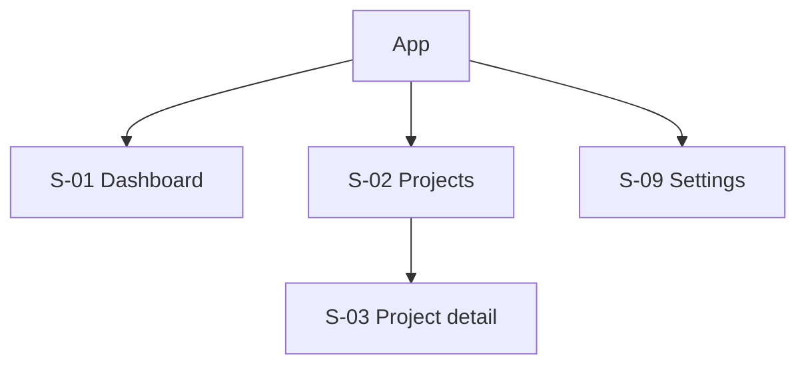
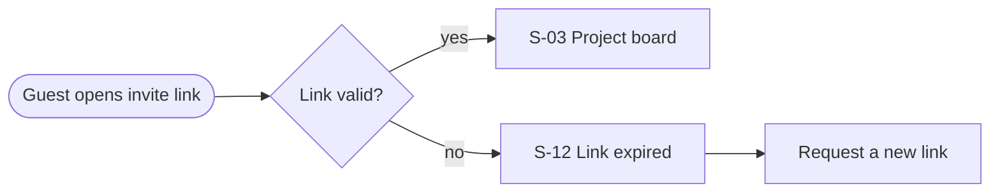

# UI-UX.md template (UX structure, before high-fidelity)

Work **low-fidelity first**: the structure, the flows and the wireframes are reviewed by the design-reviewer before any high-fidelity mockup is built. Flows and wireframes live **inside UI-UX.md** (Mermaid and text wireframes), not as separate files.

```markdown
> Status: in-review · Owner: uiux-agent · Sources: PRD.md, BA-ANALYSIS.md, contracts, BRAND-BRIEF.md · Updated: <ISO>

# UI / UX

## 1. Experience principles
3–5 principles for this product (e.g. "the next action is always visible"), each traced to a persona need or a PRD goal.

## 2. Information architecture
- Navigation model (top bar, sidebar, tabs, bottom nav on mobile) and why
- Sitemap:

- Roles and what each one sees (from the BA permission matrix)

## 3. User flows (one per journey J-…)

Each flow names its screens (S-…), its decision points, and its error and permission exits.

## 4. Wireframes (low fidelity, one per key screen)
```text
S-03 Project detail (desktop)
┌──────────────────────────────────────────────────────────┐
│ [Logo]  Projects / Apollo                    [Search] [👤] │
├──────────────┬───────────────────────────────────────────┤
│ Nav          │ H1 Apollo            [Share] [+ New task]  │
│ • Overview   │ Filters: status ▾ assignee ▾  (12 tasks)   │
│ • Tasks      │ ┌ table: title · status · assignee · due ┐ │
│ • Files      │ │ …                                      │ │
│              │ └────────────────────────────────────────┘ │
└──────────────┴───────────────────────────────────────────┘
Mobile: the nav collapses into a bottom bar; the table becomes a card list; actions go to a FAB.
```

## 5. Screen inventory
| Screen id | Name | Persona | Journey | States (mockup files) | AC covered | Contract operations | Components |
|---|---|---|---|---|---|---|---|

## 6. States matrix
| Screen | default | loading | empty | error | no-permission | offline (mobile) | partial / long content |
|---|---|---|---|---|---|---|---|
Every cell is a mockup file name, or "n/a" with the reason.

## 7. Interaction and behavior
Validation timing, optimistic updates, confirmations, undo, keyboard shortcuts, focus management after actions, motion (which transitions, with tokens), real-time or polling refresh as the architecture decided.

## 8. Responsive behavior
Breakpoints (tokens), what changes at each (navigation, tables → cards, columns), the minimum supported width (320 px), touch targets.

## 9. Accessibility plan
Landmarks and heading outline per screen, focus order for complex widgets, screen-reader announcements (toasts, async results), reduced motion, zoom to 200% / reflow at 320 px.

## 10. Copy deck
| String id | Screen / state | Text | Notes (max length, variables) |
|---|---|---|---|
Written in the BRAND-BRIEF voice (define-brand → VOICE_AND_TONE.md). Legal and marketing copy is marked `CLIENT COPY` and comes from the client.
```
