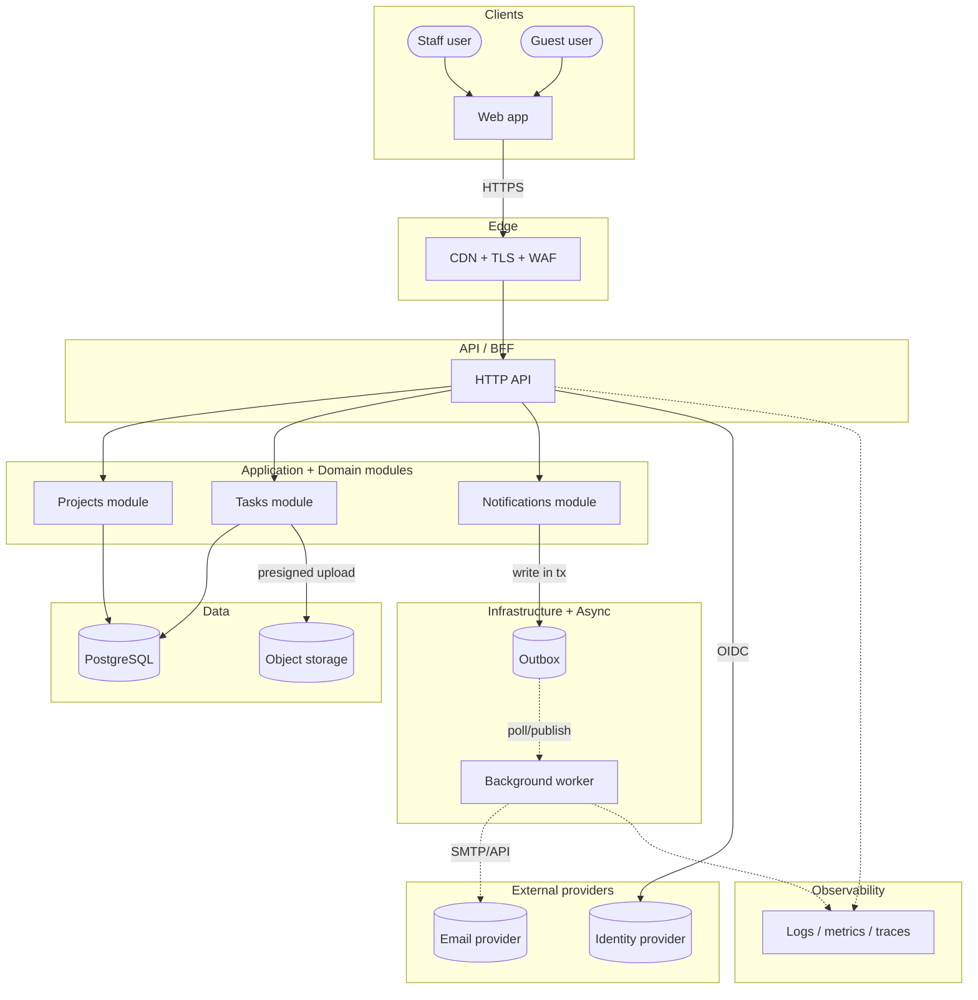
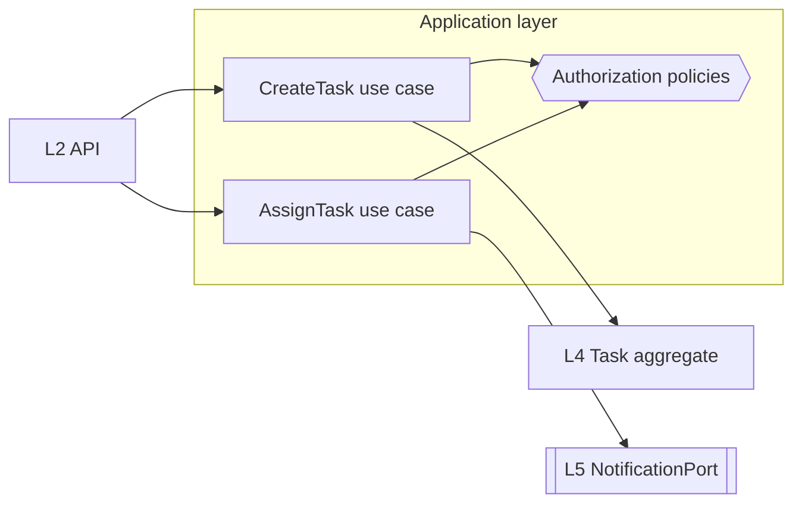

# Architecture diagrams and rationale

The architecture must be understandable **visually**. Every project gets the full diagram set below, using the same component names and ids in every diagram, plus a written **"Why this architecture"** rationale.

## Two homes, one source: the PRD and ARCHITECTURE.md
- **Every diagram is written inside `docs/delivery/PRD.md`** as a Mermaid block, so the PRD is the complete document the client reads and approves. D1 opens §10; all the others are in **§12 Architecture diagrams**. **The PRD is the source.**
- **`docs/delivery/ARCHITECTURE.md` carries an identical copy of the whole set** in **§14 Architecture diagrams**, so engineers read the diagrams next to the architecture text. The copy is generated, never typed: `bash .claude/skills/design-architecture/scripts/sync-diagrams.sh docs/delivery/PRD.md docs/delivery/ARCHITECTURE.md` writes it between the `<!-- diagrams:begin -->` and `<!-- diagrams:end -->` markers. Nobody edits inside the markers. Run it after every diagram change in the PRD.
- **No separate diagram files:** no `docs/delivery/diagrams/` folder, no `.mmd`, `.svg` or `.png` diagram exports in the repository. Rendering checks happen in a temporary directory (rule 6).
- **No copies anywhere else.** DATA-MODEL, INTEGRATIONS, DEVOPS-PLAN, THREAT-MODEL and the living docs reference a diagram by id ("see PRD §12 · D6-erd") and explain it in text. The text sections of ARCHITECTURE (§0–§13) also reference ids; the diagrams themselves sit only in its §14.
- **One writer.** The solution-architect is the only agent that writes diagrams into the PRD (it keeps the ids and names consistent). Other authors draft their diagram and send its Mermaid source to the solution-architect in a `handoff` message.
- **Earlier runs:** if `docs/delivery/diagrams/` exists, fold each diagram into the PRD under its id, then remove the folder (`git rm -r` if it's tracked).

## Required diagram set
| # | Diagram | Shows | Home in PRD | Author | Complete by |
|---|---|---|---|---|---|
| D0 | Context | The system as one box, every user type and every external system | §12 | solution-architect | G1 |
| D1 | **Main system diagram (whole app)** | Every user type, client app, edge, API/BFF, application modules, workers, data stores, caches, queues, object storage, external providers and observability, grouped by layer | **§10 (top)** | solution-architect | G1 |
| D2 | **Layer diagrams**: `D2-overview` (the dependency rule) + one per layer, `D2-L0` … `D2-L7`, `D2-X1` … `D2-X3` | The components inside the layer, their responsibilities, and their arrows to the adjacent layers only | §12 | solution-architect | G1 |
| D3 | Deployment | Environments, regions, managed services, network boundaries, what is public | §12 | solution-architect; devops-engineer refines in Lane 2 | G1, refined for G2 |
| D4 | Trust boundaries / data flow | The data classes crossing each boundary | §12 | solution-architect + cybersecurity-agent | G1 |
| D5 | Sequences: `D5-<journey>` | One per critical journey (at least one per milestone journey), across the layers | §12 | solution-architect | G1 |
| D6 | Data: `D6-conceptual` (G1, from the BA entities); `D6-erd` and `D6-states-<entity>` (Lane 2) | Entities and relationships; then the physical ERD and the state machines | §12 | solution-architect (conceptual); database-architect (ERD, states) | G1, refined for G2 |
| D7 | Integration map | External systems, direction, sync/async, webhooks | §12 | solution-architect (draft); integration-engineer refines | G1, refined for G2 |
| D8 | CI/CD flow | Stages from commit to production, gates, the artifact promotion | §12 | solution-architect (outline from `ci.kind` and `deploy.target`); devops-engineer refines | G1, refined for G2 |

So **the PRD at G1 already contains the whole set (D0–D8)**. Lane 2 only refines D3, D6, D7 and D8 (and D1 if a component changes), through the `prd-sync` step before G2 (workflow.md).

## Format of each diagram in the PRD
```markdown
### D3 · Deployment
Purpose: one line. Legend: solid = sync call, dashed = async/event, cylinder = data store, subgraph = layer or boundary.
(the Mermaid block)
**What to notice:** 1–3 bullets explaining the key decisions visible in the diagram.
```
The heading is always `### D<n>[-<suffix>] · <title>` (layer diagrams may use `####`), so the ids can be checked and referenced.

## Rules for every diagram
1. **Heading + one-line purpose + legend**, in the format above.
2. **Same names everywhere.** D1's node ids are reused in D2–D8 (e.g. `api`, `worker`, `db`, `cache`, `store`).
3. Label every arrow with the protocol or interaction (`HTTPS REST`, `SQL`, `enqueue`, `webhook`, `OIDC`).
4. Follow it with **"What to notice"**: 1–3 bullets explaining the key decisions visible in the diagram.
5. At most ~25 nodes per diagram. If it's bigger, split by layer or module, and link them.
6. Mirror, then check them: `sync-diagrams.sh` (above), then `bash .claude/skills/design-architecture/scripts/check-diagrams.sh --require "D0 D1 D2 D3 D4 D5 D6 D7 D8" --mirror docs/delivery/ARCHITECTURE.md docs/delivery/PRD.md`. It confirms every id has a heading, that the copy in ARCHITECTURE §14 is identical to the PRD (it names any missing or different diagram), and renders every block in a temporary directory outside the repo. Exit 3 means no renderer was available: say "diagram syntax not checked", and never claim a diagram renders when it hasn't been checked.

## D1 example: main system diagram (whole app)

**What to notice:** a single deployable API (a modular monolith) with modules as boundaries; all email goes through the outbox and worker, so the web request never waits on the email provider; files go directly to object storage through presigned URLs.

## D2 example: layer diagram (L3 Application)


## "Why this architecture" (required: PRD §10, right after D1; ARCHITECTURE §0 links to it)
```markdown
## Why this architecture
1. **Drivers that decided it** (weighted, from ARCHITECTURE-RESEARCH §1): e.g. team skills (5), EU residency (5), budget < X/month (4), p95 < 300 ms (4)
2. **Options considered:** C1 <style>, C2 <style>, C3 <style>, each in one line
3. **Scores:** C1 <n> · C2 <n> · C3 <n> (matrix in ARCHITECTURE-RESEARCH §4), evidence S1–S5
4. **Decision:** <style + key technologies>, ADR-00x
5. **Why it wins:** 3–5 bullets, each tied to a driver and a source
6. **Trade-offs we accept:** what this design is worse at, and why that's acceptable now
7. **What we rejected, and why:** one line per rejected option
8. **Revisit triggers:** the measurable conditions that would make us evolve it (e.g. > 1M tasks, a team > 15 developers, p95 > target at peak)
```
The rationale must be readable by a non-technical client (plain language first, technical detail second). Cost and compliance consequences are stated explicitly; they're business decisions at G1.
