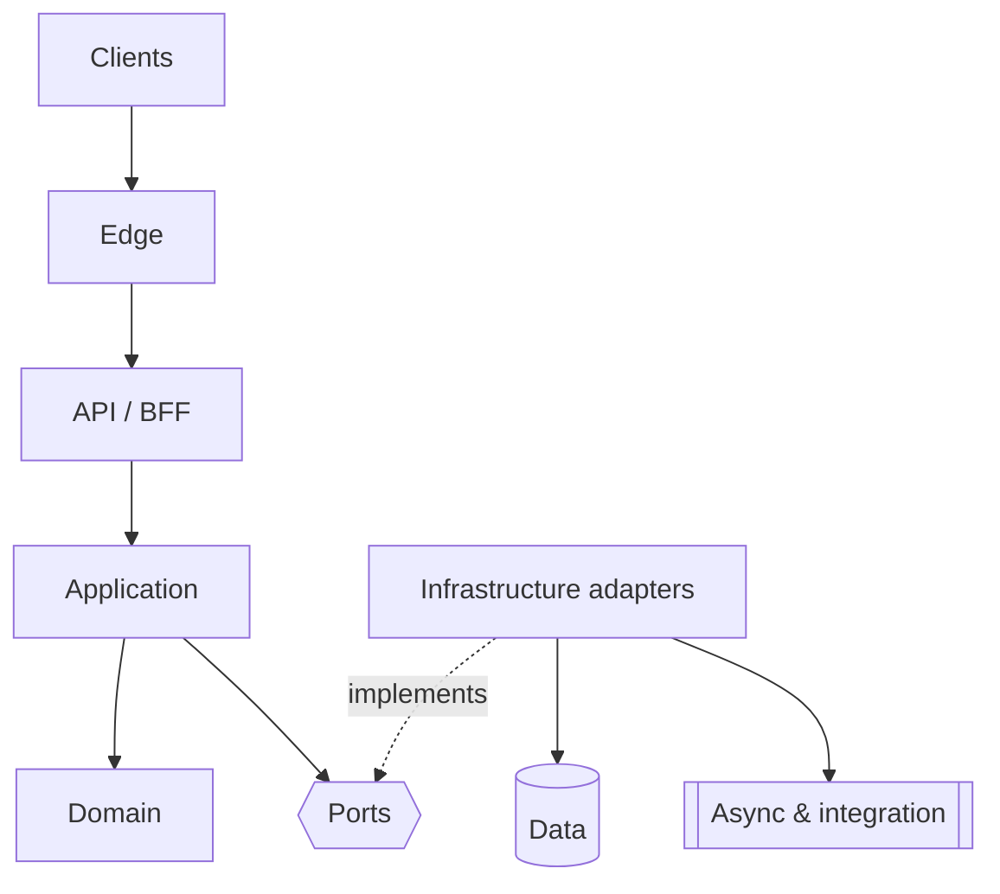
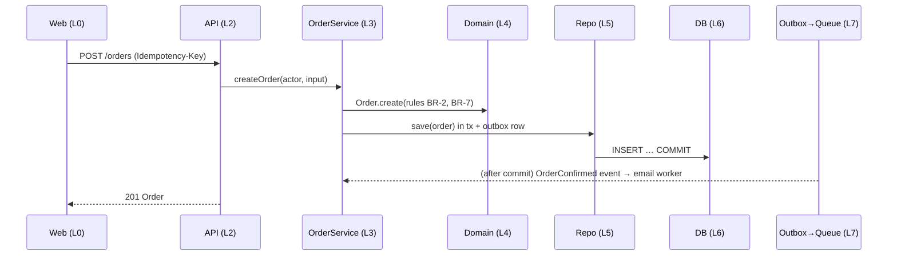

# Layer-by-layer architecture blueprint

The solution-architect fills this in for the chosen style. It appears **twice**:
- In full in `ARCHITECTURE.md §12`
- As a summary in the architect-owned section of `PRD.md` (§10, between the markers below)

## Layers
Fill in one block per layer. Mark a layer `n/a` (with the reason) when the PRD doesn't need it.

| # | Layer | Responsibility | Typical components |
|---|---|---|---|
| L0 | **Clients** | User-facing apps and external consumers | Web app, mobile app, admin console, partner integrations |
| L1 | **Edge** | Entry point, protection, delivery | DNS, CDN, TLS termination, WAF, rate limiting, static assets |
| L2 | **API / Gateway / BFF** | The contract surface: authn, routing, request validation, versioning | REST/GraphQL/RPC endpoints, BFF per client, API gateway |
| L3 | **Application (use cases)** | Orchestrate use cases, authorization decisions, transactions | Services/use-case handlers, DTO mapping, policies |
| L4 | **Domain** | Business rules and invariants, independent of frameworks | Entities, value objects, domain services, domain events |
| L5 | **Infrastructure / adapters** | Talk to the outside world through ports | Repositories, ORM, external API clients, email/payment/storage adapters, message publishers |
| L6 | **Data** | Durable state, and fast access to it | Primary DB, cache, search index, object storage, analytics store |
| L7 | **Async & integration** | Background and event-driven work | Queues, workers, schedulers, webhooks in and out, outbox relay |
| X1 | **Identity & security** (cross-cutting) | Who you are, what you may do, how data is protected | Auth provider/library, session/token handling, RBAC/ABAC, secrets store, encryption |
| X2 | **Observability** (cross-cutting) | Knowing what's happening | Structured logs, metrics, traces, health checks, alerts, audit log |
| X3 | **Delivery & config** (cross-cutting) | Building, deploying, configuring | CI/CD, IaC, environments, feature flags, config by name |

## Block format (one per layer)
```markdown
### L3 Application
- **Responsibility:** orchestrates use cases (createOrder, cancelOrder, …), enforces authorization, owns the transaction boundaries
- **Components:** OrderService, PaymentService, policies (CanCancelOrder)
- **Technology:** <framework/module system> (ADR-004)
- **Owner role:** backend
- **Folder(s):** <path from FOLDER_STRUCTURES> → project.json roles.backend.paths
- **Talks to:** L4 (in-process), L5 via ports; **never** to L0/L1 directly
- **Scaling:** stateless; horizontal instances behind the gateway
- **Failure handling:** timeouts on ports; retries only for idempotent calls; circuit breaker on the payment adapter
- **Key NFRs:** p95 < 300 ms per use case (PRD §6)
```

## Dependency rule (always state it; in the PRD this is `D2-overview` in §12)

Source-code dependencies point **inward**: L4 depends on nothing, and L3 depends on L4 plus the port interfaces. Enforce it with the stack's import-boundary lint rule or module visibility, and list that rule in `project.json → commands.lint`.

## Request flow (one per critical journey; in the PRD these are `D5-<journey>` in §12)


## Scaling stages (from ARCHITECTURE_PATTERNS)
| Stage | Trigger (a metric) | Change | Layers affected |
|---|---|---|---|
| 1 (launch) | — | Modular monolith, managed DB, CDN | — |
| 2 | p95 > target or DB CPU > 60% | Cache, read replica, workers for slow tasks | L5, L6, L7 |
| 3 | A team or module needs independent deploys | Extract module X behind the same contract | L2, L3, L5 |

## PRD section format (architect-owned)
In `PRD.md`, the architect writes between these markers. The product-manager never edits inside them:
```markdown
## 10. Solution architecture (layer by layer)
<!-- architect:begin -->
**Main system diagram (D1)** (Mermaid, whole app; see DIAGRAMS.md), followed by **Why this architecture** (5 plain-language bullets: the drivers, the options considered, the decision, the trade-offs accepted, the revisit triggers).
**Style:** <style> (ADR-00x) · **Why:** <the 2–3 drivers> · **Evidence:** ARCHITECTURE-RESEARCH.md
**Tech stack (to confirm at G1):** the table from STACK_SELECTION §6 (recommended · client preference · why · trade-off)
| Layer | What it does here | Technology | Owner role | Scales by |
|---|---|---|---|---|
| L0 Clients | … | … | frontend / mobile | CDN, static |
| … | | | | |
Dependency rule: <one line> · Critical flow: <journey> (see ARCHITECTURE §12)

## 11. Application folder structure
```text
<the tree from FOLDER_STRUCTURES, adapted to this product>
```
Folder → role ownership: <table, matching project.json roles.*.paths>

## 12. Architecture diagrams
| Id | Diagram | Shows |
|---|---|---|
| D1 | Main system (in §10) | … |
| D0, D2-overview, D2-L0 … D2-X3, D3, D4, D5-<journey>, D6-…, D7, D8 | … | … |

### D0 · Context
Purpose … Legend …
(Mermaid block)
**What to notice:** …
(… and so on for every id in the index, in that order; format: DIAGRAMS.md)
<!-- architect:end -->
```
