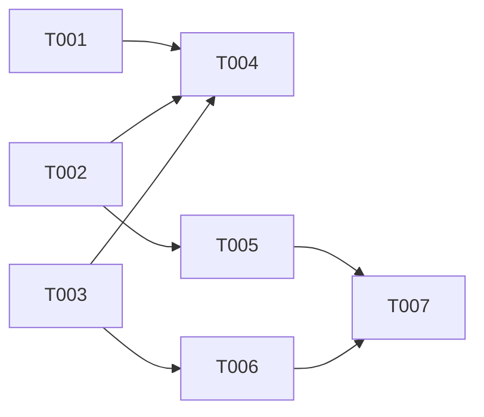

# DELIVERY-PLAN.md template

```markdown
> Status: in-review · Owner: delivery-planner · Sources: PRD.md §7, ARCHITECTURE.md, UI-UX.md, TEST-CASES.md, DEVOPS-PLAN.md · Updated: <ISO>

# Delivery plan

## Milestones
| Milestone | Goal (usable journey) | Features / AC | Exit criteria | Demo |
|---|---|---|---|---|
| ms-1 | Foundation + <journey 1> end to end on staging | F-1, AC-… | CI green, staging health 200, J-1 passes E2E | <script> |
| ms-2 | <journey 2> | | | |

## ms-1 tickets
| Ticket | Role | Title | Depends on | Size |
|---|---|---|---|---|
| T-001 | devops | CI pipeline: install, lint, typecheck, test, build | — | S |
| T-002 | backend | Scaffold API + health endpoint + codegen wiring | — | S |
| T-003 | frontend | Scaffold web app + generated client + app shell | — | S |
| T-004 | devops | Staging deploy of the walking skeleton via CI | T-001, T-002, T-003 | M |
| T-005 | backend | <operation> (AC-…) | T-002 | M |
| T-006 | frontend | <screen> against mocks (AC-…) | T-003 | M |
| T-007 | qa | E2E TC-… for J-1 | T-005, T-006 | S |
| T-0xx | frontend | Landing page (only if `F-LANDING`; in the sign-up milestone) | design foundation | M |
| T-0yy | frontend | Landing page refresh for <release> (only if `F-LANDING`; last milestone of each later release) | every feature ticket of the release | S |

## Dependency graph


## Critical path and parallel lanes
Critical path: … Parallel batches (with no file overlap): {T-001, T-002, T-003} → {T-005, T-006} → {T-004, T-007}

## Risks
| Risk | Milestone | Mitigation |
```

**Ticket count check (fill before publishing):** tickets per role per milestone (target 2–6, never more than 8) and the total (typically 20–60 for an MVP). If the count is higher, the slicing is too fine: merge siblings of the same module (TICKET_TEMPLATE → Sizing).
